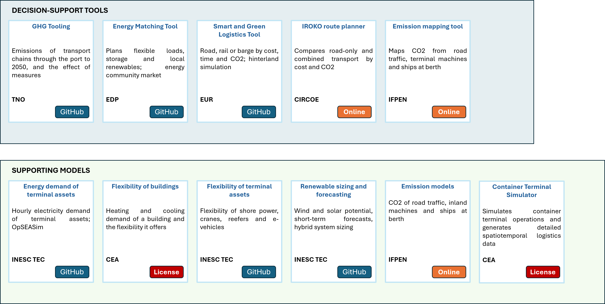

# .github
# sMArt Green Ports as Integrated Efficient multimodal hubs (MAGPIE)  

***Available software developed within the MAGPIE (WP4) EU project. This organisation provides access to the software outputs delivered under Task T4.5, categorised into decision-support tools and supporting models.***  

## List of Software  

### <u>Decision-support tools (DS)</u> 

### DS1- GREENHOUSE GAS TOOL  
Developed and maintained by TNO, this tool implements modelling and prediction capabilities to estimate GHG emissions and the impact of reduction measures both for the level of a port and on different transport corridors to and from the port.  

→ Available at: TNO   
→ Contact person: Jorrit Harmsen  
→ Email: jorrit.harmsen@tno.nl  

### DS2- ENERGY MATCHING TOOL (EMT)  
Developed and maintained by EDP NEW, the EMT uses operational data and an optimisation model to balance hourly energy supply and demand over a 24–48-hour horizon by leveraging local flexibility, energy storage, and renewable generation.  

→ Available at: https://github.com/MAGPIE-WP4-Digital-Tools/Energy_Matching_Tool  
→ Contact person: André Lisboa; João Megre; Glória Gonçalves  
→ Email: andre.lisboa@edp.pt; joao.megre@edp.pt; gloria.goncalves@edp.pt  

### DS3- SMART & GREEN LOGISTICS TOOL  
Developed and maintained by Rotterdam School of Management, the Smart and Green Logistics Tool optimises the hinterland transportation planning of the arriving containers by minimising cost, time and emissions. The tool provides an interface for the port authorities to balance cost, time and emissions while testing the impact of certain policies on the hinterland transportation network.  

→ Available at: https://github.com/MAGPIE-WP4-Digital-Tools/Smart_and_Green_Logistics  
→ Contact person: Pieter van den Berg, Orkun Tunay  
→ Email: vandenberg@rsm.nl; tunay@rsm.nl  

### DS4- IROKO ROUTE PLANNER
Developed and maintained by CIRCOE, the IROKO route planner compares road-only and combined road-rail or road-barge transport between French cities by cost and CO2 emissions, so that shippers and forwarders can see multimodal services that already exist. While currently available in French, the tool is structured to accommodate future international expansion.  

→ Available at: CIRCOE  
→ Contact person: Muriel Andurand  
→ Email: m.andurand@circoe.com; contact@circoe.com  

### DS5- EMISSION MAPPING TOOL
Developed and maintained by IFPEN, the Emission Mapping Tool is an interactive visualisation tool available as a web page for visualising road traffic, port inland machines, and ships at-berth emissions.  

→ Available at: Online
→ Contact person: Giovanni De Nunzio  
→ Website: https://mobicloud.ifpen.com/rtams/  

### <u>Supporting models (SM)</u> 

### SM1- OpSEASim  

Developed and maintained by INESC TEC, OpSEASim is an open-source Python-based simulator designed to support comprehensive modelling of container terminal energy demand and assessment of decarbonisation alternatives.  

→ Available at: https://github.com/MAGPIE-WP4-Digital-Tools/OpSEASim
→ Contact person: Zenaida Mourão   
→ Email: zenaida.mourao@inesctec.pt  

### SM2- Buildings Flexibility 

Developed and maintained by CEA, the building model is suitable for determining supply energy needs as a function of the requested setpoint temperature in a building.

→ Available at: https://github.com/MAGPIE-WP4-Digital-Tools/Building_Flexibility_Model
→ Contact person: Yves-Marie Bourien
→ Email: yves-marie.bourien@cea.fr  

### SM3- TERMINAL SIMULATOR  
Developed and maintained by CEA, the tool is a digital twin and discrete-event simulator accessible via a web interface. It enables users to load input data, run simulations, and visualise the results through various interfaces, such as dashboards, maps, and timelines.  

→ Available at: The code of the simulator is not publicly available but it can be used (online and offline) through licensing (with CEA) for further use cases and application regarding terminal activity simulation, including energy consumption and optimisation, beyond MAGPIE project  
→ Contact person: For further information regarding Port Terminal Simulator license, please feel free to contact CEAtech and CEA-Liten  
→ Email | Website: ceatech-hautsdefrance@cea.fr; https://liten.cea.fr/cea-tech/liten/english/Pages/Contact.aspx  
